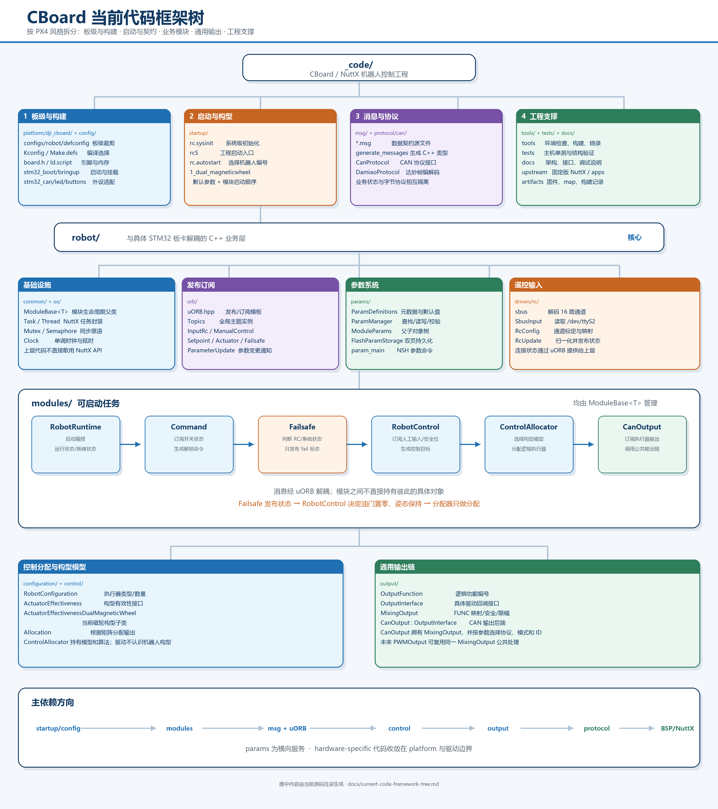

# CBoard 当前代码框架树

本页按“源码归属、运行职责、依赖方向”整理当前工程。它描述的是代码目录和对象关系，不是运行时消息时序图。



## 目录树

```text
_code/
├─ platform/dji_cboard/                 # 板级支持包（BSP）
│  ├─ configs/robot/defconfig           # NuttX 板级裁剪配置
│  ├─ include/board.h                   # 板级公开定义
│  ├─ scripts/{Make.defs,ld.script}     # 工具链、链接布局
│  └─ src/                              # 启动、CAN、LED、按键适配
│
├─ config/                              # 工程构建入口与版本/硬件清单
│  └─ nuttx/{Kconfig,Make.defs,Makefile}
├─ startup/                             # 启动策略与机器人构型选择
│  ├─ etc/init.d/{rc.sysinit,rcS,rc.autostart}
│  └─ etc/robots/1_dual_magneticwheel   # 双磁轮默认参数与模块启动
│
├─ msg/                                 # uORB 消息契约（构建时生成 C++ 类型）
├─ protocol/can/                        # CAN 协议编解码
│  └─ {CanProtocol,DamiaoProtocol}
│
├─ robot/                               # 与具体 STM32 板卡解耦的业务代码
│  ├─ common/ModuleBase.hpp             # 模块生命周期与命令入口父类
│  ├─ os/                               # Task/Thread/Mutex/Semaphore/Clock
│  ├─ orb/                              # Topics + 轻量发布/订阅
│  ├─ drivers/rc/                       # SBUS 帧解析
│  ├─ params/                           # 参数元数据、对象树、Flash 双页存储
│  ├─ configuration/                    # RobotConfiguration 构型统计父类
│  ├─ control/                          # 有效性模型与控制分配算法
│  ├─ modules/                          # 可启动任务
│  │  ├─ RobotRuntime                   # 运行时编排与状态
│  │  ├─ SbusInput → RcUpdate           # 原始遥控输入与归一化
│  │  ├─ Command                        # 解锁命令/开关状态
│  │  ├─ Failsafe                       # 只发布安全状态标志
│  │  ├─ RobotControl                   # 生成控制目标
│  │  └─ ControlAllocator               # 选择构型并分配执行器输出
│  └─ output/                           # 通用输出链
│     ├─ OutputInterface                # 驱动回调接口
│     ├─ MixingOutput                   # 功能映射、使能与安全公共处理
│     └─ CanOutput                      # CAN 后端；协议/ID 由参数选择
│
├─ tools/                               # 环境、构建、烧录、消息/ROMFS 生成
├─ tests/                               # 主机单测与分步骤结构验证
├─ docs/                                # 设计、接口、调试文档
├─ upstream/                            # 固定版本 NuttX 与 apps 源码
├─ build/                               # 构建中间产物
└─ artifacts/                           # 固件、map、构建记录
```

## 关键对象组合关系

```text
ModuleBase<T>
  └─ 各 modules 继承，统一 start/stop/status/custom_command

ControlAllocator
  ├─ 持有 ActuatorEffectiveness（按构型选择子类）
  └─ 持有 Allocation（把控制目标换算成逻辑 actuator 输出）

CanOutput : OutputInterface
  ├─ 拥有 MixingOutput（公共映射与安全门控）
  └─ 调用 CanProtocol/DamiaoProtocol（打包后写 /dev/can0）

ParamManager : ModuleParams 根节点
  ├─ 子模块参数节点/参数句柄数组
  ├─ 发布 parameter_update
  └─ 通过 FlashParamStorage 双页持久化
```

## 依赖规则

```text
startup/config
      ↓
robot/modules ──→ msg + robot/orb ──→ robot/control
      │                                  ↓
      └──────────────────────────→ robot/output
                                           ↓
                                    protocol/can
                                           ↓
                              platform/dji_cboard → NuttX

robot/params 为横向服务：模块读取参数，参数更新通过 uORB 通知。
```

- `robot/` 中的算法与业务模块不直接访问 STM32 寄存器。
- `msg/` 定义模块之间的数据契约，模块之间优先通过 uORB 解耦。
- `ControlAllocator` 只产生逻辑执行器输出；输出设备类型由 `*_FUNC` 映射和输出驱动决定。
- `MixingOutput` 处理各输出后端共有的映射、安全状态和限幅；`CanOutput` 只负责 CAN 特有的模式、ID、协议和发送。
- 新机器人构型应新增 `ActuatorEffectiveness` 子类、构型选择分支和编号启动脚本，而不是把构型判断散落进 CAN 驱动。

## 与 PX4 组织方式的对应

| 本工程 | PX4 中的相近职责 |
|---|---|
| `robot/modules/` | 独立模块/任务 |
| `msg/` + `robot/orb/` | uORB 消息与发布订阅中间件 |
| `ActuatorEffectiveness` + `Allocation` | 控制分配与构型有效性模型 |
| `MixingOutput` + `OutputInterface` | 输出功能映射、公共混控与驱动回调 |
| `platform/dji_cboard/` | board BSP、启动和外设适配 |
| `Kconfig`/`defconfig`/构建文件 | 编译期功能选择与板级配置 |
| `startup/etc/robots/` | 编号构型启动脚本和默认参数 |

