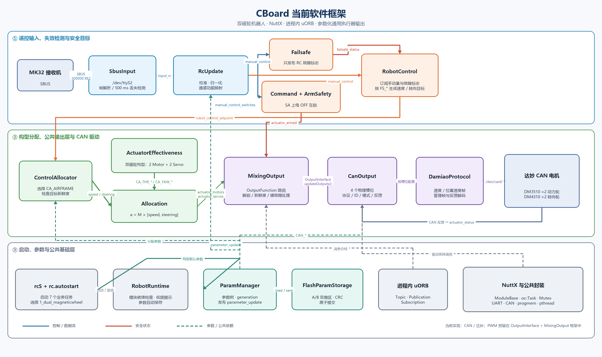

# 当前 CBoard 软件框架图

> 基于 2026-10-09 工作区当前代码生成，包含尚未提交的 `CommandRouter` 拆分、独立 `Failsafe`、`RobotControl` 和通用 `MixingOutput` 改动。



```mermaid
flowchart LR
  subgraph BOOT[启动与生命周期]
    NSH[NuttX NSH] --> RCS[rcS]
    RCS --> RT[RobotRuntime\n模块就绪检查 / 参数自动保存]
    RCS --> AUTO[rc.autostart]
    AUTO --> PROFILE[1_dual_magneticwheel\n设置构型与默认参数]
    RCS --> START[依次启动 7 个业务任务]
  end

  subgraph INPUT[遥控输入链路]
    MK32[MK32 接收机] -->|SBUS| UART[/dev/ttyS2\n100000 8E2]
    UART --> SBUS[SbusInput\n解析帧 / 500 ms 丢失检测]
    SBUS -->|input_rc| RC[RcUpdate\n校准 / 归一化 / 功能映射]
    RC -->|rc_channels| RCDIAG[诊断状态]
    RC -->|manual_control| MANUAL((manual_control))
    RC -->|manual_control_switches| SWITCH((switches))
  end

  subgraph SAFETY[控制目标与安全]
    MANUAL --> FS[Failsafe\n只检测 RC 超时]
    FS -->|failsafe_status| CTRL[RobotControl\n应用 FS_* 策略]
    MANUAL --> CTRL
    MANUAL --> CMD[Command + ArmSafety\nSA 上电 OFF 互锁]
    SWITCH --> CMD
    CMD -->|actuator_armed| ARMED((安全状态))
    CTRL -->|robot_control_setpoint| SETPOINT((速度 / 转向目标))
  end

  subgraph ALLOC[构型与控制分配]
    SETPOINT --> CA[ControlAllocator]
    EFFECT[ActuatorEffectivenessDualMagneticWheel\n2 Motor + 2 Servo\nCA_THR_* / CA_YAW_*] --> ALGORITHM[Allocation\na = M × speed,steering]
    CA --> ALGORITHM
    ALGORITHM -->|actuator_motors| MOT((Motor1 / Motor2))
    ALGORITHM -->|actuator_servos| SERVO((Servo1 / Servo2))
  end

  subgraph OUTPUT[通用输出与 CAN 驱动]
    MOT --> MIX[MixingOutput\nOutputFunction 路由\n解锁 / 新鲜度 / 硬故障处理]
    SERVO --> MIX
    ARMED --> MIX
    MIX -->|OutputInterface::updateOutputs| CAN[CanOutput\n4 个物理槽位]
    CAN -->|CAN_*_PROTO / ID / MODE| DM[DamiaoProtocol\n编码 / 解码]
    DM --> DEV[/dev/can0]
    DEV --> HW[DM3510 ×2 动力轮\nDM4310 ×2 转向轮]
    HW -->|CAN 反馈| CAN
    CAN -->|actuator_status| STATUS[位置 / 速度 / 转矩 / 温度 / 在线状态]
  end

  subgraph PARAM[参数系统]
    PCMD[param NSH 命令] --> PM[ParamManager]
    PROFILE --> PM
    FLASH[FlashParamStorage\nA/B 双扇区 + CRC] <--> PM
    PM -->|parameter_update| RC
    PM -->|parameter_update| FS
    PM -->|parameter_update| CTRL
    PM -->|parameter_update| CMD
    PM -->|parameter_update| CA
    PM -->|parameter_update| CAN
  end

  subgraph BASE[公共基础层]
    MB[ModuleBase\nstart / stop / status / task lifecycle]
    OS[os::Task / Clock / Mutex / Semaphore]
    ORB[进程内 uORB\nTopic / Publication / Subscription]
    NUTTX[NuttX 驱动与系统调用\nUART / CAN / progmem / pthread]
  end

  START -.创建任务.-> SBUS
  START -.创建任务.-> RC
  START -.创建任务.-> FS
  START -.创建任务.-> CTRL
  START -.创建任务.-> CA
  START -.创建任务.-> CAN
  START -.创建任务.-> CMD
  RT -.监视.-> START
  MB --> OS --> NUTTX
  SBUS -.使用.-> ORB
  RC -.使用.-> ORB
  FS -.使用.-> ORB
  CTRL -.使用.-> ORB
  CA -.使用.-> ORB
  CAN -.使用.-> ORB

  classDef hardware fill:#e8f1fb,stroke:#3273a8,color:#18344d;
  classDef input fill:#e8f5ff,stroke:#1683b8,color:#14384a;
  classDef safety fill:#fff0e5,stroke:#e36c21,color:#5a2a0b;
  classDef control fill:#eaf7ec,stroke:#3c9148,color:#153b1b;
  classDef output fill:#f1ebfb,stroke:#7651a8,color:#302043;
  classDef params fill:#e6f7f3,stroke:#248777,color:#123d35;
  classDef base fill:#f2f4f7,stroke:#687386,color:#29313d;
  class MK32,UART,HW,DEV hardware;
  class SBUS,RC,RCDIAG,MANUAL,SWITCH input;
  class FS,CTRL,CMD,ARMED,SETPOINT safety;
  class CA,EFFECT,ALGORITHM,MOT,SERVO control;
  class MIX,CAN,DM,STATUS output;
  class PCMD,PM,FLASH,PROFILE params;
  class MB,OS,ORB,NUTTX,NSH,RCS,RT,AUTO,START base;
```

## 关键边界

- `Failsafe` 只发布 `failsafe_status`，不转发控制量。
- `RobotControl` 根据 `FS_MOT_*`、`FS_STR_*` 生成唯一的安全控制目标。
- `ControlAllocator` 只做构型选择和矩阵分配，不判断 SA，也不直接操作 CAN。
- `MixingOutput` 是物理驱动前的公共层，统一检查解锁状态、Topic 新鲜度和输出功能映射。
- `CanOutput` 同时管理 4 个 CAN 物理槽位，并按每个槽位的参数选择协议、ID、模式和量程。
- 当前仅实现达妙 CAN 输出；未来 PWM 输出可复用 `MixingOutput` 和相同的 `OutputFunction` 绑定机制。

