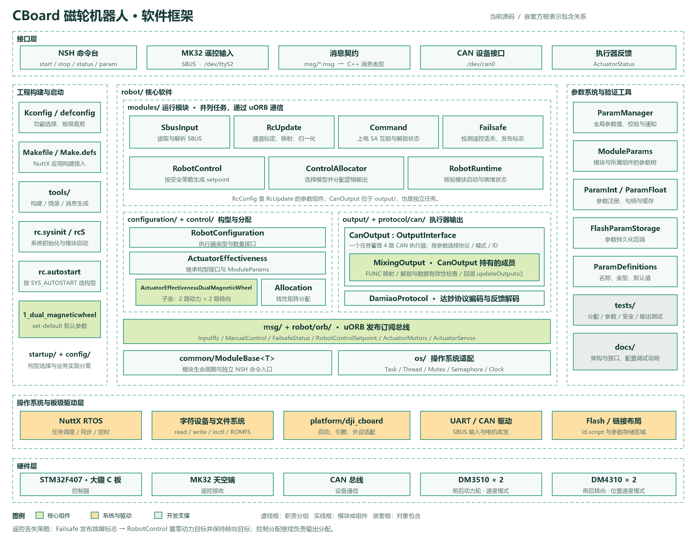

# CBoard 软件框架图

[SVG 矢量版](current-software-framework.svg)可无损放大，用于文档和汇报排版。

本图采用接口层、工程构建与启动、核心软件、参数与验证、系统驱动、硬件六个区域。虚线框表示职责分组；实线框表示模块或组件；`CanOutput` 内的 `MixingOutput` 表示实际成员对象。

核对当前源码后的关键关系：

- `modules/` 中的运行模块并列，通过 uORB 主题通信，不构成串行函数调用链。`RcConfig` 是参数组件，`CanOutput` 是位于 `output/` 的独立任务。
- `Failsafe` 发布 `FailsafeStatus`。`RobotControl` 订阅该状态并按参数生成控制目标。当前构型脚本的默认失联策略为动力目标置零、转向目标保持。
- `ControlAllocator` 持有构型有效性对象与 `Allocation`，发布逻辑动力、转向输出。
- `ActuatorEffectiveness` 继承 `RobotConfiguration` 和 `ModuleParams`；双磁轮子类声明两路动力、两路转向，并提供直接线性分配矩阵。
- `CanOutput` 实现 `OutputInterface` 并持有 `MixingOutput`；后者执行功能映射与公共安全检查，通过接口回调 `updateOutputs()`。
- `ParamManager` 管理全局参数值。`ModuleParams` 管理模块及其所属组件的参数更新树，两者没有继承关系。
- 当前图展示 CBoard 代码；尚未实现的 PWM 输出、上位机 ROS 2、MAVLink 和测厚链路不列作已有模块。

重新生成：在本目录执行 `python generate-software-framework-blocks.py`。
