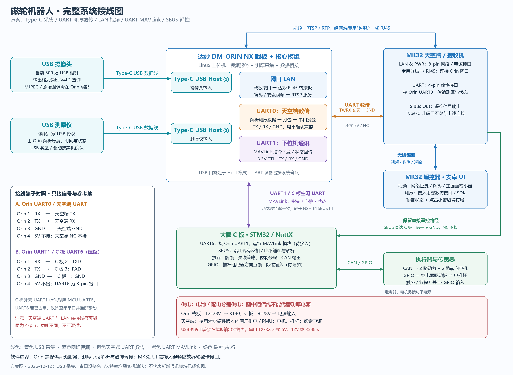

# 完整系统接线方案：USB + 数传 UART + 视频 LAN + MAVLink UART

[SVG 矢量版](full-system-wiring-usb-uart-lan-mavlink.svg)

本方案按照用户要求分开承载视频与测厚数传；属于设计接线方案，不表示所有软件模块已接入。

## 物理连接

| 起点 | 终点 | 线材/用途 |
|---|---|---|
| USB 摄像头 | Orin Type-C USB 主机口 | 支持数据的 USB 线，接口形态按设备选择 |
| USB 测厚仪 | Orin 另一个 Type-C USB 主机口 | 支持数据的 USB 线，USB 类别及驱动按实机确认 |
| Orin 网口 | 天空端 LAN & PWR 网络分支 | 达妙 RJ45 转接套件 + 普通网线 + 思翼天空端专用网口线束 |
| Orin UART0 | 天空端 UART | TX/RX 交叉，接 GND，不接 5V/NC；核对电平兼容 |
| Orin UART1 | C 板空闲 UART | 3.3V TTL，TX/RX 交叉，接 GND；运行 MAVLink |
| 天空端 S.Bus Out | C 板原有 SBUS 输入 | 保留现有反相/电平适配，接信号和 GND，NC 不接 |

图中两个 USB Host 编号仅区分用途，不是载板的物理丝印编号。不能将处于 Recovery/设备模式的端口当作 USB 主机口。若线端不是 Type-C，可按接口使用具备数据能力的转接线。

## 串口接线

Orin 两组 GH1.25 四针 UART 在载板手册中都是 1=RX、2=TX、3=GND、4=5V。物理引脚 4 的电源不参与这两条通讯链。

天空端 UART 接 Orin UART0：天空端 TX→Orin RX，天空端 RX←Orin TX，GND 相连，NC 不接。不根据插头针数、线色或表面相似程度判断线序。

C 板建议使用空闲的 MCU UART6（三针，1=GND、2=TXD、3=RXD）：Orin RX←C 板 TXD，Orin TX→C 板 RXD，GND 相连。C 板外壳“UART1”对应 MCU UART6，外壳“UART2”对应 MCU UART1。若当前 NSH 或其他任务占用了 UART6，则改选其他空闲串口，并同步调整 NuttX 和 Linux 配置。

两条 UART 独立配置波特率与帧格式。天空端数传与 Orin 对应串口匹配；MAVLink 链路与 C 板对应串口匹配。Linux 的 /dev/ttyTHS* 或 /dev/ttyS* 名称需通过实际系统确认；MK32 安卓的 /dev/ttyHS0 是另一台设备的端口，不能直接套用。

## 数据路径

- 视频：摄像头 USB → Orin 采集；H.264 可重封装，MJPEG/原始图像需编码 → RTSP/RTP → LAN → 天空端无线链路 → MK32 播放器。
- 测厚：测厚仪 USB → Orin 解析厂家协议 → 打包测量值、单位、序号、时间和状态 → 天空端 UART → MK32 数传接口 → UI 测厚图表。
- 下位机：Orin UART1 ↔ MAVLink ↔ C 板 UART；传控制命令、心跳和执行状态。如需在 MK32 显示 C 板状态，由 Orin 接收后通过天空端数传转发。
- 遥控：MK32 摇杆/开关 → 天空端 SBUS → C 板。此路径保留直接遥控，不要求 Orin 转发摇杆值。

天空端 UART 不会自行把测厚仪 USB 数据变成可显示的数值；需要 Orin 桥接与 MK32 接收解析程序。MAVLink 和厂家测厚协议不混为一个协议；如选择 MAVLink 来承载测厚遥测，两端需要约定消息字段或自定义 dialect。

## 供电

- Orin 载板输入范围按所提供 V2.X 手册为 12–28V；C 板为 8–28V。
- 天空端使用实际硬件版本对应的原厂电源/PMU，不用 UART 电源脚供电，不把 LAN & PWR 的电源脚接到达妙网络信号脚。
- 电机、推杆使用对应额定功率电源；GPIO 经驱动/继电器控制，不直接驱动负载。
- USB 摄像头和测厚仪电流合计需满足载板 USB 电源预算，必要时采用适当的独立供电 USB Hub，并避免反向供电。

## 资料依据

- 达妙《DM-ORIN NX V2.X 使用说明书 V1.0》印刷第 4 页：UART 引脚；第 8–9 页：网口。
- 大疆《RoboMaster 开发板 C 型用户手册》印刷第 10–11 页：UART 与线序、外壳标识对应关系。
- 思翼《MK32 v1..v1.pdf》第 17 页：天空端引脚；第 105–106 页：地面端数传接口；第 140–143 页：网络视频与地址。
