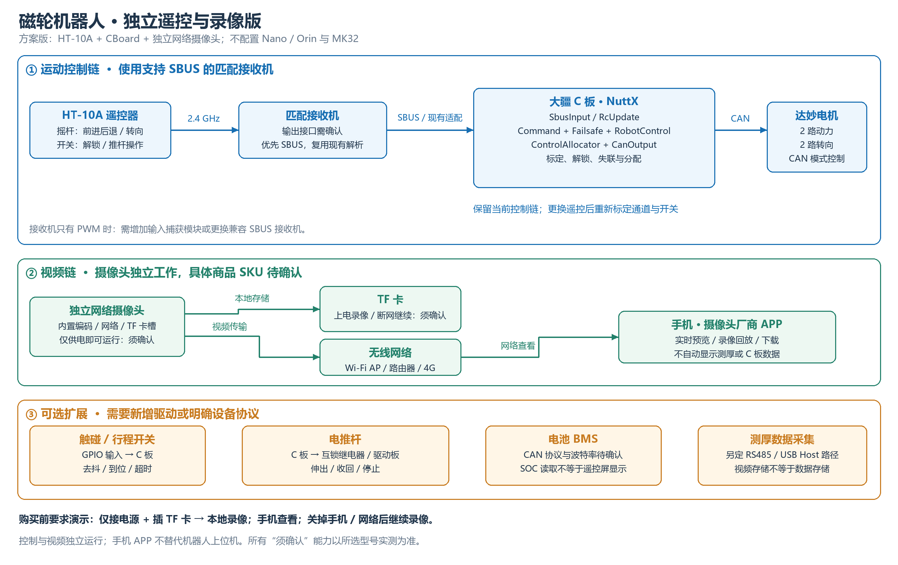
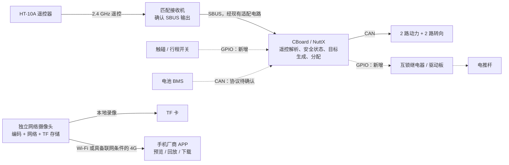

# 独立遥控与录像版方案：HT-10A + CBoard + 网络摄像头

日期：2026-10-10。此页为单独设计方案，不表示所有扩展驱动已实现。

## 可行性结论

遥控运动与独立录像可以在不安装 Nano/Orin 上位机、不使用 MK32 的条件下实现。前提是摄像头确实具有独立编码、网络连接和 TF 卡录像能力，而接收机提供可供 CBoard 读取的遥控输出。单纯 USB UVC 摄像头不能仅靠电源和 STM32 完成此方案。

淘宝短链接未能完整读取；商品标题中的 Wi-Fi、4G、USB、4K 不等于所选套餐全部具备这些功能。以下将该摄像头视为“满足条件后的网络摄像头”，购买前需由卖家确认具体 SKU。

## 系统连接

控制链与视频链只需要分别供电即可工作；不要求 CBoard 转发视频。共用电池时，分别使用符合设备规格的稳压电源支路。接收机与 CBoard 信号参考地、电平、SBUS 极性必须匹配现有接线。

## 遥控与软件复用

- 沿用 `SbusInput → RcUpdate → RobotControl → ControlAllocator → MixingOutput/CanOutput` 的主链。
- `Command + ArmSafety` 根据指定开关通道生成解锁状态；开关名字不决定通道编号，需要重新确认映射。
- `Failsafe` 发布故障标志；目标生成层按当前策略将动力目标置零并保持转向目标。
- 重新标定通道端点、中位、反向、死区和开关位置。HT-10A 的输出通道数及顺序不能直接套用 MK32 的标定值。
- 优先选择卖家明确确认支持 SBUS 且与 HT-10A 配对的接收机。若所选接收机只有 PWM，需要新增定时器输入捕获及遥控输入模块，或使用兼容 SBUS 接收机。
- 必须测试关掉遥控器后的接收机行为。若接收机继续发送“保持最后值”的有效帧，单靠输入超时可能检测不到失联；需要验证 SBUS 失联标志，或将接收机失控输出配置为动力零、解锁开关关闭并验证下位机响应。

## 摄像头采购确认

要求卖家演示“仅接直流电源、不接电脑”的工作过程，并确认：

1. 所选 SKU 内置编码与系统，支持手机 APP 实时查看。
2. 有 TF 卡槽，支持上电自动录像；无手机、无互联网时仍持续录像。
3. 支持本地回放、文件下载和循环覆盖，告知容量、文件系统和分段规则。
4. Wi-Fi 支持手机直连 AP 还是只支持连接路由器；若仅 STA，应增加热点/路由器。
5. 4G 是否内置模块、天线与 SIM 卡接口，还是需要另外的 4G 路由器；远程观看需具备相应联网条件。
6. 4K30 是本地录像、USB 输出还是网络主码流规格；手机预览分辨率、延迟需实测。
7. 支持工作时同时录像与直播，视频断网不影响本地存储。
8. 供电电压、最大功耗、散热、防护、补光、镜头视角与最近对焦距离。

厂商展示的 YLX-258-Z1 网络相机资料具有独立编码、TF 卡和网络接口，说明这种产品架构可行；但尚未证明它与用户淘宝链接的型号/套餐相同，不能据此直接确认该链接的功能。

## 测厚、电推杆和电池的边界

电推杆和限位开关可由 CBoard 实现，不依赖 Linux 上位机。需要新增 GPIO 输入去抖、推杆状态机、继电器方向互锁、到位停止、运行超时和失联停止逻辑。推进方向不能同时导通；板上 GPIO 通过合适驱动连接继电器模块，不直接带线圈。

视频 TF 卡只存储摄像头视频，不自动收集测厚仪数据。现有测厚仪 USB 协议说明是数据报文说明，不足以确认实际 USB 设备类别、接口驱动和 UART/RS485 可用性。若使用另一份资料中的 RS485 型号，需要确认实际采购仪器支持 RS485，再新增收发器、串口协议和数据存储。若仪器只能 USB 通信，则必须补充 USB Host 驱动支持或另加小型数据采集设备。不要把仪器 USB 线直接接 MCU UART。

HT-10A 的通道设置屏幕不等于可安装自定义安卓软件。没有确认厂家开放遥测与界面协议前，不将其列作厚度曲线、故障详情、SOC 的显示终端。手机厂商摄像头 APP 通常负责视频，也不能自动显示 CBoard 的厚度与电池数据；需要额外遥测链路和专用软件才能整合。

电池 CAN 解析可在 CBoard 上实现，需明确实际 BMS 报文、ID、波特率与电气接口。若 BMS 与达妙电机波特率不一致，不能直接并接到同一 CAN 总线；需独立可用 CAN 通道或网关。CBoard 读到 SOC 不代表 HT-10A 屏幕会显示 SOC。

## 分阶段验收

1. 确认接收机型号、SBUS、电平/极性，完成通道映射及标定。
2. 架空轮子验证上电 OFF 互锁、前进后退、转向和遥控失联处理。
3. 摄像头仅供电，上电自动录像；手机接入后能实时查看与读取录像。
4. 关闭手机/断开网络，确认录像继续；重新联网检查回放和文件完整性。
5. 在实际钢板、安装位置和距离下测试遥控与视频覆盖，不以商品标称距离作为现场保证。
6. 若增加推杆，验证限位、方向互锁、超时、失联停止。
7. 若保留测厚与电池显示，再确认仪器接口、BMS 协议和数据显示路径。

## 参考资料与确认状态

- [HOTRC 官方技术中心](https://www.hotrc.cn/support/7.html)：提供 HT-10A 产品支持入口。
- [HT-10A 产品说明资料](https://www.rcscomponents.kiev.ua/datasheets/HT-10A_2.4Ghz_10CH_.pdf)：厂家说明书的经销商托管副本；包括通道、基本回传说明，不用于推断自由开发界面。
- [HOTRC 官方接收机目录](https://www.hotrc.cn/products/22.html)：F-10A、SBUS-A 等为不同型号，实际套餐输出接口仍需确认。
- [YLX-258-Z1 厂商资料](https://www.globalfactorylink.com/seecaps/en/products/Network-camera-module.html)：网络相机独立编码与存储的参考案例，未确认就是淘宝商品。
- 用户提供的淘宝商品链接：详情未核实，不给出最终采购确认。
